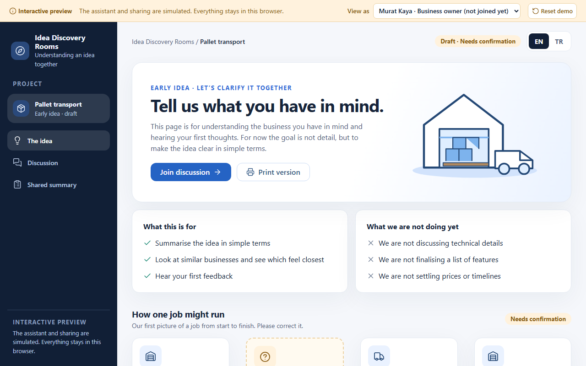
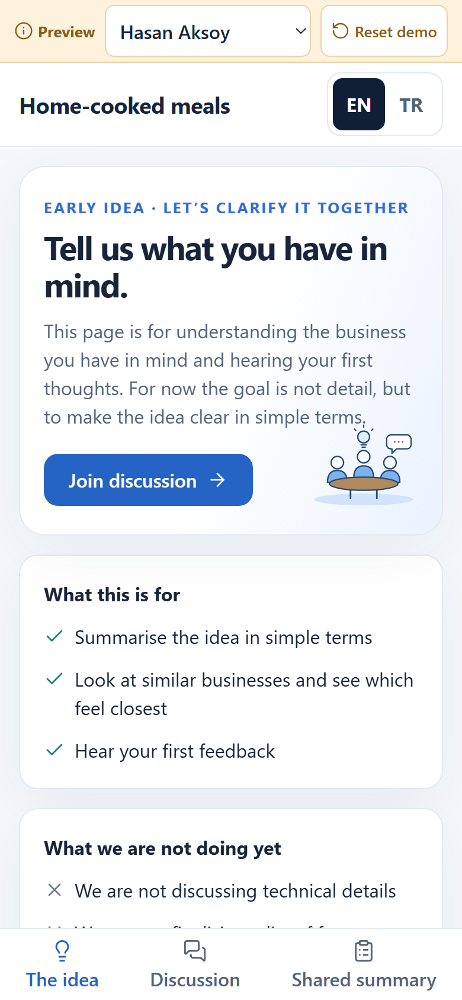

# Idea Discovery Rooms

A web app where a software consultant and business owners clarify a business
idea together, helped by an AI assistant. Each project has a room with three
sections: **The idea**, **Discussion** and **Shared summary**. Nobody needs to
be online at the same time.

The app collects business requirements: what the business is, who it serves,
how a job runs and how money is made. It is not the owners' business app, and
it does not judge whether the idea will work. Owners can use it in English or
Turkish.

**Status:** Phase 1 in progress: M0 done, M1 underway. See the
[milestones](https://github.com/burakata/idea-discovery-app/milestones).

## How it works

- **The consultant approves what the AI sends.** By default nothing the AI
  writes reaches owners until the consultant approves, edits or rejects it.
- **Nothing unconfirmed is shown as fact.** Every statement is Confirmed, an
  Early interpretation or an Open question, and is labelled as such.
- **Owners react, the consultant confirms.** Owners mark a statement "Right"
  or "Not right"; only the consultant moves it to Confirmed.

The full scope is in the [Phase 1 PRD](docs/prd/Idea_Discovery_Rooms_Phase_1_PRD.md),
and every decision in [docs/decisions.md](docs/decisions.md).

## The prototype

**[Try the demo](https://burakata.github.io/idea-discovery-app/)** in your
browser. The AI and sharing are simulated, and each visitor's demo lives only
in their own browser: nothing is sent anywhere, and **Reset demo** starts
again.

The idea page in the clickable prototype, on desktop and on a phone. The
"Home-cooked meals" project is invented sample data.




## Roadmap

- [M1 · Real collaborative foundation](https://github.com/burakata/idea-discovery-app/milestone/2): sign-in, projects and a shared discussion, without AI.
- [M2 · Lead AI, approvals and control](https://github.com/burakata/idea-discovery-app/milestone/3): the AI Lead, AI modes per conversation and the approval queue.
- [M3 · Understanding, specialist oversight and outputs](https://github.com/burakata/idea-discovery-app/milestone/4): reactions and confirmation, private specialists, summaries and diagrams.
- [M4 · Pilot hardening](https://github.com/burakata/idea-discovery-app/milestone/5): polish, privacy, backups and a pilot with real owners.

## Running it

**The web prototype** (demo data in your browser) needs Node.js 20.19 or
later, or 22.12 or later:

```
npm --prefix src/web install
npm --prefix src/web run dev
```

Open http://localhost:5173 and press **Try the demo**. Once in, **View
as**, in the strip at the top, switches between the owners and the
consultant; **Reset demo** starts again. [PROTOTYPE.md](PROTOTYPE.md) lists
what is simulated.

**The API** needs the .NET 10 SDK. It has sign-in by email link, projects,
invitations, asking to join, conversations, and one image per project
(re-encoded on the server with SkiaSharp):

```
dotnet test src/api
dotnet run --project src/api/IdeaDiscovery.Api --launch-profile http
npm --prefix src/web run dev:api
```

The last two run the real client against a local API; sign in with a link
from the emails saved in `src/api/IdeaDiscovery.Api/emails/`. The room's
idea page, shared summary and discussion use the API; Burak's queue and
private notes are demo-only until the API has them.

## What is where

| Path | Contents |
|---|---|
| `src/web/` | The client: React, Vite and TypeScript, built as the demo or against the API |
| `src/api/` | The API: ASP.NET Core on .NET 10, with its tests |
| `prompts/` | The AI assistant's prompts, read from these files |
| `docs/prd/` | The Phase 1 PRD, the single source of scope, with its milestones (§11) and future feature register (§12) |
| `docs/playbook/` | The AI Discovery Playbook v1.1, which the Lead's prompts are written from |
| `docs/archive/` | Superseded documents: the v1 brief and the v0.1 PRD PDF |
| `docs/design.md` | Look and layout rules, for phone and desktop |
| `docs/decisions.md` | Product and technical decisions, and open questions |
| `docs/engineering.md` | Principles for writing and reviewing code |
| `docs/design-review/` | Design and owner-test reports, with screenshots |
| `docs/reference/` | The earlier prototype and the printed feedback document, for reference only |
| `tools/` | The docs link check, and `tools/screenshots/` for review screenshots |
| `.claude/` | The Claude Code setup: the dev loop, subagents and skills |

## How work is done

- **One loop for every change.** Every change goes through the dev loop in
  `.claude/skills/dev-loop/SKILL.md`: plan, implement, review, verify,
  report.
- **Claude Code does the work, in three roles:**
  - a lead session plans, reviews and reports;
  - an implementer subagent writes the code;
  - a code-reviewer subagent reviews it, with a security-reviewer subagent
    for the API, sign-in, AI calls and configuration.
- **A branch and pull request for each task.** Only the project owner merges
  into `main`, and only once the required CI checks pass.
- **Milestones and acceptance tests on GitHub.** The PRD's milestones M0 to M4
  are GitHub milestones, and its acceptance tests A01 to A16 are issues
  labelled `acceptance-test`, each in the milestone whose exit criteria name
  it.

The real build is an ASP.NET Core API on .NET 10 with SQLite and a React
client, hosted on Hetzner in Germany, with email through Resend and the
Claude API called from the server only. See
[docs/decisions.md](docs/decisions.md).
